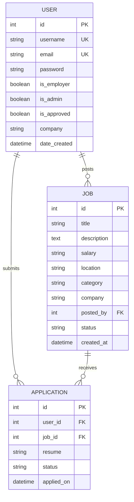

# 💼 JobPortal — Modern Career & Hiring Web Application

[](https://www.python.org/)
[](https://flask.palletsprojects.com/)
[](https://www.sqlalchemy.org/)
[](https://getbootstrap.com/)
[](https://www.sqlite.org/)
[](LICENSE)

A recruitment and job portal web application built with **Python**, **Flask**, and **SQLAlchemy**. Designed with a modern, high-contrast SaaS interface, role-based access control (RBAC), multi-criteria search & filtering, real-time application status tracking, secure PDF resume uploading, and custom in-page confirmation workflows.

---

## 📑 Table of Contents
- [✨ Key Highlights](#-key-highlights)
- [📸 User Interface Showcase](#-user-interface-showcase)
- [⚡ Quick Demo Credentials](#-quick-demo-credentials)
- [🚀 Features by Role](#-features-by-role)
- [🛠️ Tech Stack](#️-tech-stack)
- [📂 Project Architecture](#-project-architecture)
- [⚙️ Installation & Running Locally](#️-installation--running-locally)
- [📊 Database Schema](#-database-schema)
- [👤 Author](#-author)

---

## ✨ Key Highlights

- **🎨 Modern SaaS UI & Palette:** Electric Indigo & Cyber Violet branding with glassmorphic sticky navigation, responsive job cards, and ambient background lighting.
- **🔍 Multi-Column Job Filtering:** Real-time keyword search, interactive category selector, location search, and 1-click **Trending Search Pills** (*Remote, Backend, Frontend, AI & Data*).
- **🛡️ Custom In-Page Confirmation Modals:** Replaced native browser popups with custom frosted-glass confirmation dialogs for sign out, candidate decisions, and vacancy publishing.
- **📁 Secure PDF Resume Uploads:** PDF file upload dropzone with client-side validation and collision-safe file naming (`resume_u{user_id}_j{job_id}_{timestamp}.pdf`).
- **🔔 Toast Alert System:** Notification banners with animated status icons (`✓` Success, `✕` Danger, `⚠️` Warning, `ℹ️` Info) that smoothly auto-dismiss after 4.5 seconds.
- **👥 Role-Based Access Control:** Distinct user flows for **Administrators**, verified **Employers**, and **Job Seekers**.

---

## 📸 User Interface Showcase

| 🌟 Home Page & Job Search | 🛡️ Administrator Dashboard |
| :---: | :---: |
|  |  |

| 🔐 Authentication & Role Registration | 🏢 Post New Vacancy |
| :---: | :---: |
|  |  |

| 📄 Candidate Application View | 📬 Employer Applications Review |
| :---: | :---: |
|  |  |

---

## ⚡ Quick Demo Credentials

A default administrator account is automatically verified upon launching the application:

| Role | Email Address | Password | Permissions |
| :--- | :--- | :--- | :--- |
| **Super Admin** | `admin@jobportal.com` | `admin123` | System monitoring, employer approval/revocation, full applicant records |
| **Employer** | *(Register with "Hire Talent")* | *(Your password)* | Post vacancies, review incoming resumes, accept/reject candidates *(requires admin approval)* |
| **Candidate** | *(Register with "Find a Job")* | *(Your password)* | Instant access to explore listings, upload PDF resume, track application status |

---

## 🚀 Features by Role

### 🛡️ Super Administrator
* **KPI Metrics Overview:** Real-time counts of Candidates, Employers, Active Job Openings, and Resumes Submitted.
* **Employer Verification:** Review pending employer registrations and approve or revoke posting permissions.
* **Master Applications Oversight:** View all platform applications with direct access to inspect submitted PDF resumes.
* **Status Decision Controls:** Transition application status across `Pending`, `Under Review`, `Accepted`, and `Rejected`.

### 🏢 Hiring Employer
* **Interactive Registration:** Toggle between Candidate and Employer during sign up; dynamic company name requirement.
* **Publish Vacancies:** Create listings with job title, compensation range, location, category suggestions, and detailed descriptions.
* **Received Applications Dashboard:** Dedicated employer portal to review candidates who applied for their specific openings with instant resume downloads.
* **Status Updates:** Update applicants directly to `Under Review`, `Accepted`, or `Rejected`.

### 👤 Job Seeker / Candidate
* **Explore Openings:** Filter by keyword, category, location, or click popular trending search tags.
* **Seamless Application:** Two-column apply view with full job details and a PDF dropzone with live filename preview.
* **Duplicate Application Prevention:** Prevents accidental double submissions for the same role.
* **Application Tracker:** Personal dashboard displaying real-time application status badges (`⏳ Pending Review`, `🔍 Under Review`, `✓ Accepted`, `✕ Not Selected`).

---

## 🎯 AI Mock Interview & Multi-Language Compiler System

JobPortal features an integrated **Dual-Round AI Interview Simulator** that prepares candidates before actual interviews:

### 1. 🎥 Round 1: Face-to-Face AI Interview Simulator
* **Live Webcam Self-View:** Real-time candidate video streaming with camera and microphone controls.
* **AI Recruiter Persona (Voice & Waveform):** Interactive animated AI avatar with responsive audio soundwave visualization.
* **Spoken AI Questions:** Browser Text-to-Speech (TTS via Web Speech API) speaks questions aloud with natural pacing.
* **Speech-to-Text Voice Recording:** Candidates can speak their responses into their microphone; speech is transcribed in real-time, or they can type and edit their answers directly.
* **Adaptive Questioning:** Behavioral, technical architecture, and crisis management questions matched specifically to each role.

### 2. 💻 Round 2: Technical Coding IDE (Multi-Language Online Compiler)
* **Real-Time Code Execution:** Interactive split-pane IDE supporting 7+ programming languages:
  * **Python 3** (local high-speed sandbox)
  * **JavaScript** (Node.js engine)
  * **Java** (OpenJDK compiler & runtime)
  * **C++** (GCC compiler)
  * **C** (GCC compiler)
  * **Go** (Golang runner)
  * **Rust** (Rust compiler)
* **Custom Stdin & Test Cases:** Test code against custom inputs and pre-loaded problem test cases.
* **Terminal Diagnostics:** Live console output with standard output (`stdout`), compilation/runtime error tracking (`stderr`), and execution latency in milliseconds.

### 3. 🤖 Instant AI Performance Report & Scorecard
* **Overall Score (0-100)** with letter grades (`A+`, `B+`, etc.) and actionable hiring recommendations.
* **Four-Dimension Diagnostic Breakdown:**
  * Communication & Articulation
  * Technical Architecture & Concepts
  * Problem Solving & Algorithmic Logic
  * Code Correctness & Compilation
* **Personalized Strengths & Improvement Opportunities.**
* **Persistent History:** Registered candidates can revisit past scorecards and review model answers anytime under `My Scorecards`.

### ⚡ How Newly Posted Jobs are Handled:
When an employer or admin publishes a new job vacancy:
1. **Dynamic Domain & Keyword Extraction:** The system inspects the job's `title`, `category`, and `description` to identify core competencies (Backend, Frontend, Full-Stack, AI & Data, DevOps, Mobile).
2. **Dynamic Interview Question Generation:** It personalizes behavioral and architectural questions using the job title and company name, and assigns relevant domain focus areas.
3. **Targeted Technical Challenge Mapping:** It pairs the job with an appropriate algorithmic or system problem, automatically pre-loading working starter boilerplate in all 7 programming languages.
4. **Immediate Availability:** The job card automatically displays a **"🎯 Practice Interview"** button linking directly to `/interview/<job_id>`.

---

## 🛠️ Tech Stack

* **Backend Framework:** [Flask 3.x](https://flask.palletsprojects.com/) (Python)
* **Database & ORM:** [Flask-SQLAlchemy](https://flask-sqlalchemy.palletsprojects.com/) with [SQLite](https://www.sqlite.org/)
* **Authentication:** [Flask-Login](https://flask-login.readthedocs.io/) & [Werkzeug Security](https://werkzeug.palletsprojects.com/) (Password Hashing)
* **Frontend UI:** HTML5, CSS3, JavaScript, [Bootstrap 5.3](https://getbootstrap.com/), [Plus Jakarta Sans](https://fonts.google.com/specimen/Plus+Jakarta+Sans) Google Font
* **File Handling:** Secure PDF resume uploads via Werkzeug `secure_filename`

---

## 📂 Project Architecture

```
job-portal/
├── app.py                      # Application factory, database models & route controllers
├── config.py                   # Flask & SQLAlchemy configuration
├── interview_engine.py         # AI question generator, multi-language compiler & evaluation
├── requirements.txt            # Python dependencies
├── run_app.bat                 # 1-Click Windows startup launcher
├── README.md                   # Project documentation
│
├── assets/
│   └── screenshots/            # UI screenshots for documentation
│
├── instance/
│   └── jobportal.db            # SQLite database file (auto-initialized)
│
├── static/
│   ├── css/
│   │   ├── base.css            # Design tokens, glassmorphic navbar, toasts & modal dialogs
│   │   ├── index.css           # Hero section, floating search card, job grid & avatars
│   │   ├── forms.css           # Auth cards, role switcher tiles & form controls
│   │   ├── admin.css           # Metric KPI cards & administrative data tables
│   │   ├── application.css     # PDF dropzone, application status badges & tracking
│   │   └── interview.css       # Webcam feed, speech waves, IDE & terminal styles
│   ├── js/
│   │   ├── base.js             # Legacy query param toast handler
│   │   └── register.js         # Interactive role switcher logic
│   └── resumes/                # Secure storage for uploaded candidate PDF resumes
│
└── templates/
    ├── base.html               # Master layout (Navbar, Toasts, Confirmation Modal, Footer)
    ├── index.html              # Home page with search, trending tags & job listings
    ├── login.html              # Clean authentication page
    ├── register.html           # Role selection registration (Candidate vs. Employer)
    ├── post_job.html           # Job vacancy creation form
    ├── apply_job.html          # Two-column job description & resume upload dropzone
    ├── my_applications.html    # Candidate application tracking dashboard
    ├── applications.html       # Employer received applications & decision controls
    ├── admin.html              # Superuser administration dashboard
    ├── interview_hub.html      # AI Mock Interview portal & track selection
    ├── interview_room.html     # Dual-round live simulator (Webcam + IDE Compiler)
    └── my_interviews.html      # Historical interview performance scorecards
```

---

## ⚙️ Installation & Running Locally

### Prerequisites
* **Python 3.10+** installed on your system.
* **Git** installed on your system.

### 1. Clone the Repository
```bash
git clone https://github.com/Yashbanda18052003/job-portal.git
cd job-portal
```

### 2. Set Up a Virtual Environment
```bash
# Windows
python -m venv env
env\Scripts\activate

# macOS / Linux
python3 -m venv env
source env/bin/activate
```

### 3. Install Required Dependencies
```bash
pip install -r requirements.txt
```

### 4. Run the Application

**Option A — Windows 1-Click Launcher:**
Double-click `run_app.bat` in the root folder.

**Option B — Terminal:**
```bash
python app.py
```

Open your browser and navigate to:
```
http://127.0.0.1:5000
```

> **Note:** The SQLite database and seed administrator (`admin@jobportal.com` / `admin123`) are automatically initialized on the first application launch.

---

## 📊 Database Schema



---

## 👤 Author

**Yash Banda**  
* GitHub: [@Yashbanda18052003](https://github.com/Yashbanda18052003)  
* LinkedIn: [linkedin.com/in/yash-banda-829633259](https://www.linkedin.com/in/yash-banda-829633259/)
