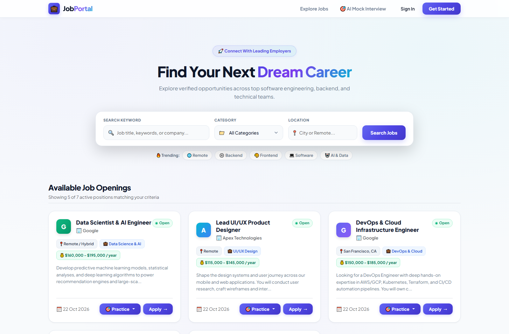
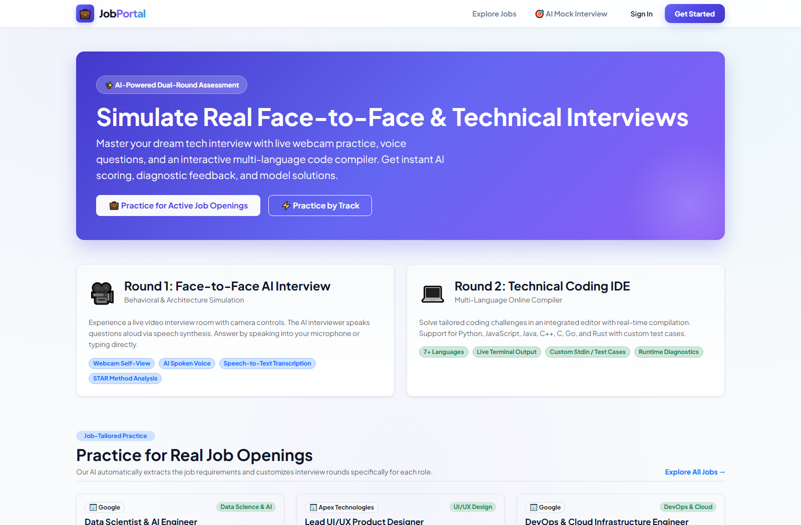
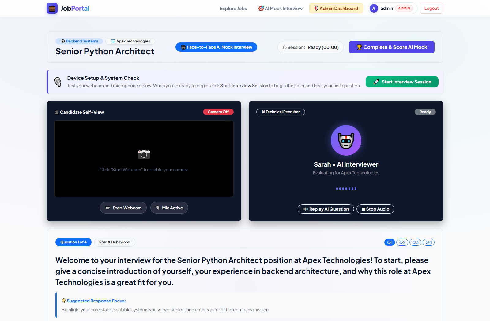
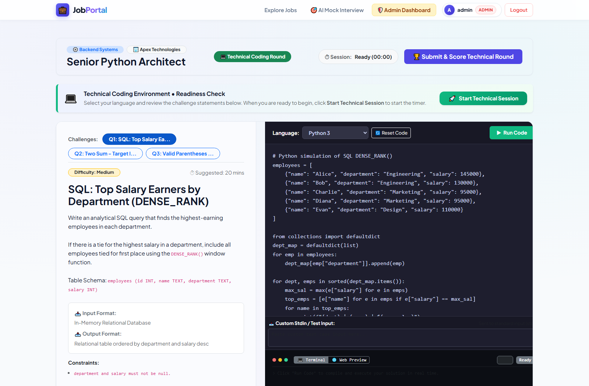
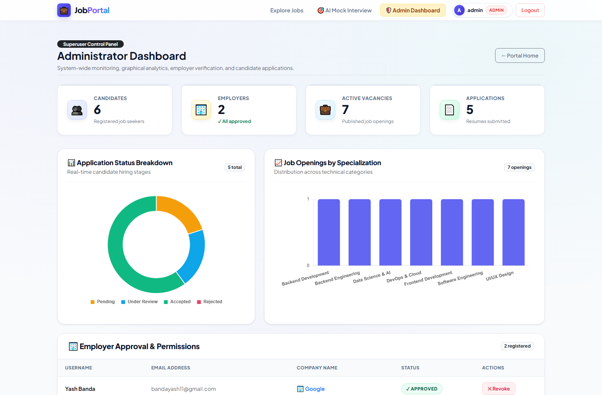
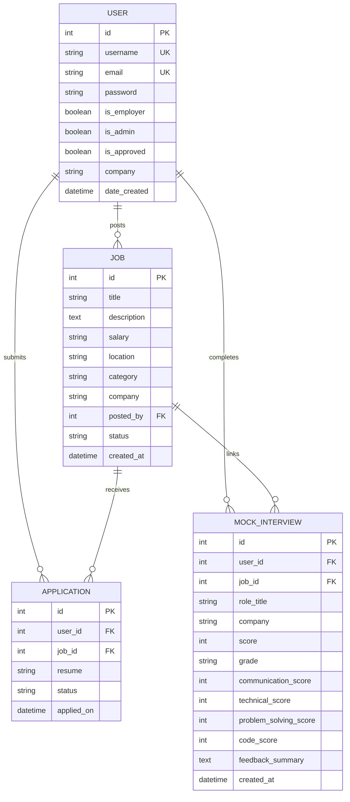

# 💼 JobPortal — Modern Career, Recruitment & AI Interview Platform

[](https://www.python.org/)
[](https://flask.palletsprojects.com/)
[](https://www.sqlalchemy.org/)
[](https://getbootstrap.com/)
[](https://www.sqlite.org/)
[](https://www.chartjs.org/)
[](https://wandbox.org/)
[](LICENSE)

A recruitment and hiring web application built with **Python**, **Flask**, and **SQLAlchemy**. Featuring an electric modern SaaS theme, role-based access control (RBAC), interactive Chart.js graphical analytics, 5-record pagination, PDF resume uploading, and an **AI Interview Simulator with separated Face-to-Face Voice Mock and 12-Language Technical Coding Sessions**.

---

## 📑 Table of Contents
- [✨ Key Highlights](#-key-highlights)
- [📸 User Interface Showcase](#-user-interface-showcase)
- [⚡ Quick Demo Credentials](#-quick-demo-credentials)
- [🚀 Features by Role](#-features-by-role)
- [🎯 AI Interview Practice System](#-ai-interview-practice-system)
  - [1. 🎥 Face-to-Face AI Mock Interview](#1--face-to-face-ai-mock-interview-modef2f)
  - [2. 💻 Technical Coding Round & Cloud IDE](#2--technical-coding-round--cloud-ide-modetechnical)
  - [3. 🌟 Combined Dual Round](#3--combined-dual-round-modefull)
  - [4. 🤖 AI Scoring & Competency Report](#4--ai-scoring--competency-report)
- [🛠️ Tech Stack](#️-tech-stack)
- [📂 Project Architecture](#-project-architecture)
- [⚙️ Installation & Running Locally](#️-installation--running-locally)
- [📊 Database Schema](#-database-schema)
- [🔌 API Endpoints](#-api-endpoints)
- [👤 Author & Contributions](#-author--contributions)

---

## ✨ Key Highlights

- **🎨 Modern SaaS Design:** Electric Indigo, Cyber Violet, and Slate gradients with frosted glass navigation, ambient glow highlights, responsive job cards, and unified action buttons.
- **🎯 Decoupled Interview Practice:** Candidates can independently choose **Face-to-Face AI Mock Interview** or **Technical Coding Round** or **Combined Dual Round** without forced transitions.
- **⏱️ Zero-Pressure Controlled Timer:** Camera and microphone preview can be calibrated at ease—the practice timer stays stopped at `00:00` until the candidate explicitly clicks **"🚀 Start Session"**.
- **💻 12-Language Cloud Compiler & IDE:** Full-featured split-pane editor with test cases supporting **Python, JavaScript, PHP 8.3, SQL (SQLite tables), HTML/CSS (Live Preview), Dart, Swift, Java, C++, C, Go, and Rust**.
- **🔀 Dynamic Non-Repeating Questions:** Technical coding challenges and behavioral questions are dynamically sampled using `random.sample()` across retries, guaranteeing fresh questions every session.
- **📊 Admin Visual Analytics & Pagination:** Interactive **Chart.js** graphical analytics (Application Status doughnut and Category breakdown bars), KPI metric cards, and clean **5-records-per-page** pagination without CSS artifacts.
- **📄 Complete Resume Workflow:** Drag-and-drop PDF resume submission, collision-safe file naming, employer review dashboard, and instant 1-click **Accept / Reject** applicant decisions.
- **🛡️ Protected Practice & RBAC:** Secure `@login_required` barriers ensuring candidates' mock scorecards and code histories are safely recorded to their profile.

---

## 📸 User Interface Showcase

### 🌟 Modern Discovery & AI Practice Hub
| 🏠 Modern Homepage & Practice Dropdown | 🎯 AI Interview Track Hub |
| :---: | :---: |
|  |  |

---

### 🎥 Face-to-Face Mock & 💻 Technical IDE Simulator
| 🎥 Face-to-Face AI Mock Interview | 💻 Multi-Language Cloud Compiler & IDE |
| :---: | :---: |
|  |  |

---

### 🛡️ Administrative Oversight & Visual Analytics
| 📊 Admin Interactive Analytics & Pagination | 🏢 Post New Job Vacancy |
| :---: | :---: |
|  |  |

---

### 📬 Recruitment Workflow & Applications Tracking
| 📄 Candidate Application View | 📬 Employer Applications Review |
| :---: | :---: |
|  |  |

---

## ⚡ Quick Demo Credentials

A seed administrator account is verified automatically upon launching the application:

| Role | Email Address | Password | Capabilities |
| :--- | :--- | :--- | :--- |
| **Super Admin** | `admin@jobportal.com` | `admin123` | Visual Chart.js analytics, employer approval/revocation, 5-per-page job management, master candidate resume review |
| **Hiring Employer** | *(Register as "Hire Talent")* | *(Your password)* | Post vacancies, review incoming candidate resumes, update status (*requires admin approval*) |
| **Job Seeker** | *(Register as "Find a Job")* | *(Your password)* | Apply with PDF resume, track application status, take AI Mock & Technical practice sessions |

---

## 🚀 Features by Role

### 🛡️ Super Administrator
* **Graphical Visual Analytics:** Interactive Chart.js graphs displaying real-time application distribution and category metrics.
* **KPI Metrics Counters:** Instant counters for Total Jobs, Total Candidates, Approved Applications, and Shortlist Ratio.
* **Paginated Job Records:** Strict 5-record pagination with previous/next controls, clean page numbers, and zero visual bullet artifacts.
* **Employer Verification:** Review pending employer registrations and grant/revoke job publishing privileges.
* **Resume Inspection & Decisions:** Direct access to submitted PDF resumes with 1-click **Accept** and **Reject** status triggers.

### 🏢 Hiring Employer
* **Role Switcher Registration:** Dedicated employer signup flow with company profile linking.
* **Publish Vacancies:** Create listings with job title, salary range, location, industry domain, and rich job specifications.
* **Applicant Review Dashboard:** Private employer portal to inspect applicants for each active listing with downloadable resumes.
* **Decision Controls:** Move candidates seamlessly through `Under Review`, `Accepted`, and `Rejected` statuses.

### 👤 Job Seeker / Candidate
* **Smart Search & Trending Filters:** Filter openings by keyword, category, location, or click popular trending search pills (*Remote, Backend, Frontend, AI & Data*).
* **PDF Resume Uploading:** File dropzone with client-side format validation and filename preview.
* **Application Tracker:** Personal dashboard displaying real-time application badges (`⏳ Pending Review`, `🔍 Under Review`, `✓ Accepted`, `✕ Not Selected`).
* **Personal Scorecard History:** Revisit completed AI practice sessions, grades, and detailed feedback under `My Scorecards`.

---

## 🎯 AI Interview Practice System

JobPortal offers a practice ecosystem designed to help candidates prepare for real-world technical and behavioral screenings:

```
                  ┌─────────────────────────────────────────┐
                  │          Job Card / Practice            │
                  └────────────────────┬────────────────────┘
                                       │
            ┌──────────────────────────┼──────────────────────────┐
            ▼                          ▼                          ▼
   [ ?mode=f2f ]              [ ?mode=technical ]            [ ?mode=full ]
 🎥 Face-to-Face AI         💻 Technical Coding Round     🌟 Combined Dual Round
  - Live Webcam & Mic        - 12 Language Compilers       - Stage 1: Face-to-Face
  - Animated Audio Waves     - Challenge Switcher (Q1-Q3)  - Stage 2: Technical IDE
  - Speech Recognition       - Dynamic Random Problems     - Comprehensive Report
  - Direct Completion        - Instant Terminal Output
```

### 1. 🎥 Face-to-Face AI Mock Interview (`?mode=f2f`)
* **Camera & Audio Sandbox:** Calibrate webcam and microphone with real-time waveform visualization before beginning.
* **Controlled Start Button:** Timer stays safely at `00:00` until you click **"🚀 Start Interview Session"**.
* **Dual Speech Interaction:**
  * **AI Voice Synthesis:** The AI interviewer speaks questions aloud with natural voice inflection.
  * **Voice Speech-to-Text:** Live transcription captures spoken answers via the Web Speech API with an in-place typing fallback.
* **Dynamic Non-Repeating Prompts:** Evaluates STAR method behavioral situations, system resilience, and architectural patterns selected dynamically per attempt.
* **Independent Finish:** Click **"🏆 Complete Mock Interview"** to get your verbal scorecard directly—**no coding round forced**.

### 2. 💻 Technical Coding Round & Cloud IDE (`?mode=technical`)
* **Pre-Session Readiness Banner:** Read problem specifications and constraints before clicking **"🚀 Start Technical Session"** to start the clock.
* **12 Supported Execution Compilers:**
  1. **Python 3** (High-speed local execution)
  2. **JavaScript** (Node.js engine)
  3. **PHP 8.3** (Associative arrays, recursion & algorithmic handlers)
  4. **SQL** (In-memory SQLite with pre-populated tables & ASCII result output)
  5. **HTML/CSS** (Live interactive web preview frame)
  6. **Dart** (Dart 3 environment with structure & entrypoint analysis)
  7. **Swift** (Swift 5 compiler & runtime)
  8. **Java** (OpenJDK Cloud runner)
  9. **C++** (GCC Cloud runner)
  10. **C** (GCC Cloud runner)
  11. **Go** (Golang Cloud runner)
  12. **Rust** (Rust Cloud runner)
* **Multi-Challenge Switcher (Q1, Q2, Q3):** Switch seamlessly between problems using quick tabs; written code is preserved per problem.
* **Dynamic Algorithmic Bank:** Includes *Valid Parentheses*, *Merge Intervals*, *Reverse Words*, *SQL Top Earners with DENSE_RANK*, *PHP Array Normalization*, *Dart Streams*, *Swift Common Prefix*, and *DevOps Log Parsing*.

### 3. 🌟 Combined Dual Round (`?mode=full`)
* Candidates complete both the verbal AI screening and the technical coding test for a full 360-degree assessment.

### 4. 🤖 AI Scoring & Competency Report
* **Mode-Specific Calculations:** Evaluates performance accurately based on the active session mode without penalizing skipped rounds.
* **Four-Dimension Diagnostic Breakdown:**
  * 🗣️ **Verbal Communication & STAR Quality**
  * 🏛️ **Technical Architecture & Keyword Depth**
  * 🧩 **Problem Solving & Algorithmic Approach**
  * 💻 **Code Correctness & Compilation Sanitation**
* **Scorecard Modal:** Provides overall score (0–100), letter grade (`A+`, `B+`, `C`, `D`), hiring verdict (*Strong Hire*, *Hire*, *Potential Match*, *Needs Preparation*), strengths, and targeted improvement suggestions.

---

## 🛠️ Tech Stack

| Category | Technology |
| :--- | :--- |
| **Backend Framework** | [Flask 3.1](https://flask.palletsprojects.com/) (Python) |
| **Database & ORM** | [Flask-SQLAlchemy 3.1](https://flask-sqlalchemy.palletsprojects.com/) & [SQLite](https://www.sqlite.org/) |
| **Authentication & RBAC** | [Flask-Login 0.6](https://flask-login.readthedocs.io/) & [Flask-Bcrypt](https://flask-bcrypt.readthedocs.io/) |
| **Frontend UI & Styling** | [Bootstrap 5.3](https://getbootstrap.com/), HTML5, Modern CSS Variables, Plus Jakarta Sans |
| **Data Visualization** | [Chart.js 4.x](https://www.chartjs.org/) |
| **Cloud Compilers** | Wandbox API, Node.js, CPython, SQLite In-Memory Engine |
| **Browser APIs** | Web Audio API (AnalyserNode), Web Speech API (`SpeechRecognition` & `SpeechSynthesis`) |
| **File Handling** | Werkzeug `secure_filename` (PDF resume storage) |

---

## 📂 Project Architecture

```
job-portal/
|-- .env.example                # Sample environment configuration
|-- .gitignore                  # Git ignore rules for venv, db, and cache
|-- README.md                   # Comprehensive documentation & setup guide
|-- app.py                      # Application factory, DB models & route controllers
|-- config.py                   # Flask & SQLAlchemy database configuration
|-- interview_engine.py         # AI question generator, 12 compilers & scoring
|-- requirements.txt            # Python dependencies
|-- run_app.bat                 # 1-Click Windows startup launcher
|
|-- assets/
|   +-- screenshots/            # High-resolution UI showcase images
|       |-- 01_home_modern.png
|       |-- 02_interview_hub.png
|       |-- 03_f2f_ai_mock_room.png
|       |-- 04_technical_cloud_ide.png
|       |-- 05_admin_dashboard.png
|       |-- Add job page-job portal.png
|       |-- Admin page-job portal.png
|       |-- Employer application view page - job portal.png
|       |-- Home page-Job portal.png
|       |-- Login page-job portal.png
|       |-- Register page-job portal.png
|       +-- User application view page-job portal.png
|
|-- instance/
|   +-- jobportal.db            # SQLite database file (auto-seeded on launch)
|
|-- static/
|   |-- css/
|   |   |-- admin.css           # Metric KPI cards & administrative data tables
|   |   |-- application.css     # PDF dropzone & application status tracking
|   |   |-- base.css            # Modern design tokens, navbar, toasts & modals
|   |   |-- forms.css           # Authentication cards & role switcher tiles
|   |   |-- index.css           # Hero section, search filters & job cards
|   |   +-- interview.css       # Webcam feed, soundwave animation, IDE & terminal
|   |-- images/
|   |-- js/
|   |   |-- base.js             # Notification toasts & modal helpers
|   |   +-- register.js         # Interactive role selection logic
|   +-- resumes/                # Uploaded candidate PDF resumes
|       +-- .gitkeep
|
+-- templates/
    |-- admin.html              # Superuser dashboard with Chart.js & pagination
    |-- applications.html       # Employer received applications & decision controls
    |-- apply_job.html          # Two-column job description & PDF upload dropzone
    |-- base.html               # Master layout with navigation & flash toasts
    |-- index.html              # Homepage with search filters & Practice dropdown
    |-- interview_hub.html      # AI Mock Interview track portal
    |-- interview_room.html     # Mode-aware simulator (F2F Voice Room & Cloud IDE)
    |-- login.html              # User login page
    |-- my_applications.html    # Candidate application tracker
    |-- my_interviews.html      # Candidate historical interview scorecards
    |-- post_job.html           # Job vacancy publishing form
    +-- register.html           # Role selection registration (Candidate vs Employer)
```

---

## ⚙️ Installation & Running Locally

### Prerequisites
* **Python 3.10+** installed on your system.
* **Git** installed on your system.

### 1. Clone the Repository
```bash
git clone https://github.com/Yashbanda18052003/job-portal.git
cd job-portal
```

### 2. Create and Activate a Virtual Environment
```bash
# Windows (PowerShell / Command Prompt)
python -m venv env
.\env\Scripts\activate

# macOS / Linux
python3 -m venv env
source env/bin/activate
```

### 3. Install Python Dependencies
```bash
pip install -r requirements.txt
```

### 4. Run the Application

**Option A — Windows 1-Click Launcher:**
Double-click `run_app.bat` in the project root directory.

**Option B — Command Line:**
```bash
python app.py
```

### 5. Access the Web Application
Open your web browser and visit:
```
http://127.0.0.1:5000
```

> **Automatic Setup:** The SQLite database (`instance/jobportal.db`) and default administrator account (`admin@jobportal.com` / `admin123`) are initialized automatically on first startup.

---

## 📊 Database Schema



---

## 🔌 API Endpoints

| Method | Endpoint | Description | Access |
| :--- | :--- | :--- | :--- |
| `GET` | `/` | Homepage with job search, filters & practice dropdown | Public |
| `GET` | `/interview_hub` | AI practice domain tracks & role selector | Public |
| `GET` | `/interview/<job_id>?mode={f2f\|technical\|full}` | Mode-aware live interview simulation room | Login Required |
| `POST` | `/api/compile-run` | Compile & execute code across 12 languages | Login Required |
| `POST` | `/api/submit-interview` | Submit interview responses & compute AI score | Login Required |
| `GET` | `/my-interviews` | Candidate's historical scorecards & feedback | Candidate |
| `GET` | `/admin/dashboard?page={n}` | Admin analytics with Chart.js & 5-record pagination | Super Admin |
| `POST` | `/admin/applicant/<id>/<status>` | Update candidate application decision | Super Admin / Employer |

---

## 👤 Author & Contributions

**Yash Banda**  
* GitHub: [@Yashbanda18052003](https://github.com/Yashbanda18052003)  
* LinkedIn: [linkedin.com/in/yash-banda-829633259](https://www.linkedin.com/in/yash-banda-829633259/)

Contributions, feedback, and issue reports are always welcome! Feel free to open a pull request or submit an issue on the [GitHub repository](https://github.com/Yashbanda18052003/job-portal).
